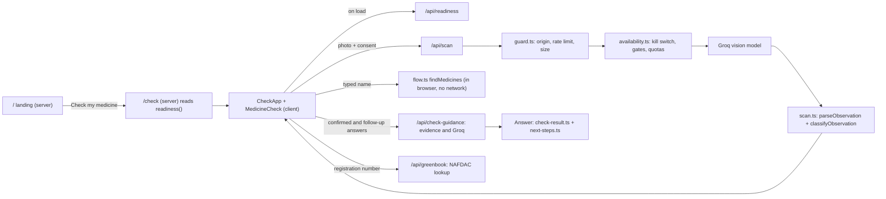
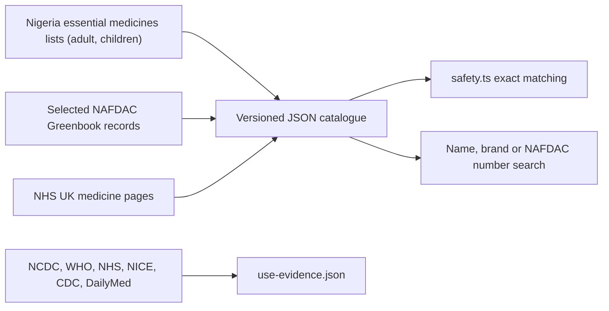

# Architecture and data

How the code is put together, where data comes from, and the patterns every new feature should follow. For what the product does and why, read [`PROJECT_MAP.md`](../PROJECT_MAP.md) first.

## Stack

| Layer | Choice | Notes |
|---|---|---|
| Framework | Next.js 16 (App Router), React 19 | This version has breaking changes. Read `node_modules/next/dist/docs/` before using a Next.js API. |
| Language | TypeScript, strict | `npm run typecheck` |
| Styling | Plain CSS with tokens in `app/tokens.css` | Tailwind 4 is installed but the components use plain CSS classes. |
| Icons | `lucide-react` | The only UI dependency. |
| Fonts | Bricolage Grotesque, Fraunces italic via `next/font/google` | Loaded in `app/layout.tsx`. |
| AI | Groq REST API through `lib/groq.ts` | Server only. The key never reaches the browser. |
| Data | Static JSON in `data/` | No database. |
| Tests | `node:test` + `tsx` | `npm test` runs `tests/*.test.ts`. |
| Hosting | Vercel, Node runtime | API routes are required, so no static export. |

## How a request flows



## Folder layout

```
app/
  page.tsx, landing.css          Landing page (night)
  check/page.tsx                 Checker route; passes aiPaused to CheckApp
  layout.tsx                     Fonts, tokens.css, globals.css
  tokens.css                     Every colour, size, space and motion value
  globals.css                    Shared classes (buttons, notes, focus, catalogue, pilot)
  components/<Name>.tsx          One component per file
  components/<name>.css          That component's styles, every class prefixed with the name
  api/<route>/route.ts           Server routes: scan, readiness, explain, use-evidence
lib/                             Plain TypeScript. No React. Imported by components, routes and tests.
data/                            Catalogue, aliases, evidence, fixtures (JSON)
tests/                           node:test files, one per lib module or feature
scripts/                         Review packet, regression and smoke scripts
public/                          Test labels, pilot protocol, generated review packet
docs/                            This file, operations, user guide, spec template, evidence
.claude/skills/                  Project skills for Claude Code (verify, ui-check, add-feature, ...)
```

## The patterns to follow

### 1. Logic in `lib/`, rendering in components
Anything worth testing is a plain function in `lib/<feature>.ts` with no React and no browser APIs. Components import it and only render. Examples: `scanOutcome()` and `answerCards()` in `lib/flow.ts` drive `MedicineCheck.tsx` and `Answer.tsx`; `whatsAppLink()` in `lib/next-steps.ts` drives `NextSteps.tsx`.

### 2. Every word lives in a copy module
- Checker UI text: `lib/screen-copy.ts` (`copy.home`, `copy.photo`, `copy.confirm`, `copy.answer`, ...).
- Landing text: `lib/landing-copy.ts`.
- Medical text: `lib/safety.ts` and `data/*.json`. Never edit it for presentation.
- Feature text that a pharmacist must review: its own `lib/<feature>.ts` (for example `lib/next-steps.ts`, `lib/how-it-works.ts`).

`tests/flow.test.ts` scans `lib/screen-copy.ts` for forbidden words such as "safe" and "approved".

### 3. Screens are state, not routes
`/check` is one client component. The current screen is `Screen` in `lib/flow.ts` (`home | find | catalogue | photo | confirm | reason | prescription | other-medicines | follow-up | answer`). `MedicineCheck.tsx` moves between them with `go()`, which scrolls to the top and moves focus to the screen's `h1`. Footer pages are `View` values in `CheckApp.tsx`. To add a screen: add it to `Screen`, render it in `MedicineCheck.tsx` with `data-motion="screen"` and a back button, and add its words to `copy`.

### 4. AI assistance and source-based fallback
- Every AI route checks `sameOrigin()` and `allow()` (`lib/guard.ts`), then `authorizeAI()` (`lib/availability.ts`).
- AI output is parsed into a fixed shape and rejected on any surprise (`parseObservation`, `validateSelection`, `validateEvidenceOrder`).
- Photo scan failures offer name search. Guidance failures retain required questions and source-based results.
- The primary medicine is matched in code and confirmed by the user. Groq can propose companion-name corrections from the catalogue.
- Logs go through `operationalEvent()` with fixed codes only.

### 5. Reviewed content has a fingerprint
`scripts/review-packet.mjs` lists every file holding medical or user-facing text. It writes `public/review-packet.json` and `data/content-manifest.json` with a SHA-256 of those files. `next.config.ts` and `tests/beta.test.ts` fail if the fingerprint is stale. When you add a file with user-facing text, add it to that `files` list and add a checklist id.

### 6. Privacy by construction
The checker sends consented photos and guidance inputs through its server routes. The optional WhatsApp preview includes the user’s answers only when they select the corresponding sharing options.

## API routes

| Route | Method | Input | Output | Used by |
|---|---|---|---|---|
| `/api/readiness` | GET | none | `{ai, clinicalReview, pilot, ...}` operational state only | `MedicineCheck.tsx` on load |
| `/api/scan` | POST | `{image: data URL}` (JPEG/PNG, ≤ 2 MB after preparing) | `ScanResult` from `lib/scan.ts`, plus `reason` on fallback | Photo screen |
| `/api/check-guidance` | POST | Confirmed medicine, reason, prescription, companion medicines and optional follow-up answers | Questions or cited guidance and source-based fallback | Checker |
| `/api/greenbook` | POST | NAFDAC registration number | Registry match or dated fallback when available | Checker |
| `/api/explain` | POST | `{id, scenario}` | Selected fixed paragraphs and questions | HIDDEN (`AskResistGuard.tsx`) |
| `/api/use-evidence` | POST | `{topic}` | Reordered passage IDs | HIDDEN (`UseCheck.tsx`) |

## Data files

| File | Contents | Edit rules |
|---|---|---|
| `data/medicines.json` | 16 original generic records (UK sources) | Only when asked. Regenerate the review packet. |
| `data/nigeria-catalogue.json` | 12 records from the Nigeria Essential Medicines Lists 2024, formulation examples, 5 Greenbook product references, source register | Same |
| `data/ingredient-aliases.json` | Spellings and salt forms mapped to base names | Never add a brand name |
| `data/use-evidence.json` | Source-linked education and checker passages | Same |
| `data/scan-fixtures.json` | Expected outcomes for the 10 test labels | Keep in sync with `public/test-labels/` |
| `data/dashboard.json` | Synthetic numbers for the hidden dashboard | Fake by design |
| `data/content-manifest.json` | Written by the review script | Never hand-edit |

### How each source is used



- **Nigeria Essential Medicines Lists 2024 (adult and children).** Generic records and formulation examples with page or section references.
- **NAFDAC Greenbook.** Five product names and registration numbers for search. The separate checker lookup queries the live registry and can fall back to dated saved records. A product reference can block a scan match but never create one.
- **NHS UK and one UK manufacturer leaflet.** Sources for the original 16 records.
- **NCDC, WHO, CDC, NICE, NHS, DailyMed.** Education passages.
- **NHIA 2026 and WHO AWaRe.** Linked in the source register for professional review only. No treatment recommendation from them is used.

### Adding or changing content

1. Confirm the exact record and source section.
2. Store the source URL, section, check date and `pending_pharmacist` status.
3. Add a test (see `tests/nigeria-catalogue.test.ts` for source traceability checks).
4. Run `node scripts/review-packet.mjs`. This changes the fingerprint and resets any pharmacist approval.
