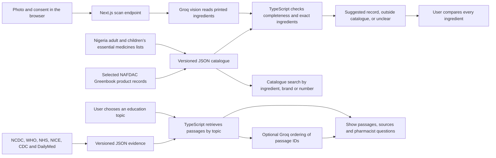

# How ResistGuard uses its sources

## Files and roles

| File | What it contains |
|---|---|
| `data/medicines.json` | The original source-linked generic catalogue. |
| `data/nigeria-catalogue.json` | Twelve additional generic ingredient records, selected formulation and package-strength examples, five Greenbook product references, and the source register. |
| `data/ingredient-aliases.json` | Explicit generic salt or spelling equivalents used in exact matching. Brand search remains a catalogue feature. |
| `data/use-evidence.json` and `lib/use-check.ts` | Short source-linked passages, topic-to-passage retrieval, and questions to take to a pharmacist. The browser keeps the selected answers and sends only a topic ID if the user requests AI ordering. |

Next.js hosts the React interface and the server API routes on Vercel. Groq reads photos when a user consents. Catalogue search and evidence retrieval work with the checked-in JSON. The visual AMR lesson uses predefined educational steps. Local guidance includes NCDC’s stewardship fact sheet.

## How each Nigerian dataset is used

- **Nigeria Essential Medicines Lists for adults and children, 2024.** Source for generic records and selected formulation examples with page or section references. Package strengths describe the form listed in the source. Clinical suitability and dosing need professional assessment.
- **NAFDAC Greenbook.** Selected examples connect ingredient records to specific product names and registration numbers. The register is the reference for current status. A product name helps the user search. Scan confirmation still requires the ingredient panel.
- **NCDC.** Its AMR fact sheet provides local stewardship context. The educational cases link to their own verified guidance.
- **NHIA 2026 and WHO AWaRe.** The source register links to the documents for chapter-level review by a pharmacist and clinician. Individual treatment recommendations need that review before any future use in a patient-facing feature.
- **DailyMed.** Product-label evidence supports the triple-antibiotic ingredients and the existing medicine-safety examples.

New additions follow the same process. Confirm the exact record and source section, store the source version and check date, record professional review status, and regenerate the review packet. The demo currently labels the content **pharmacist review pending**.
