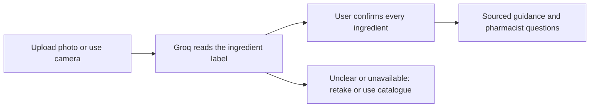
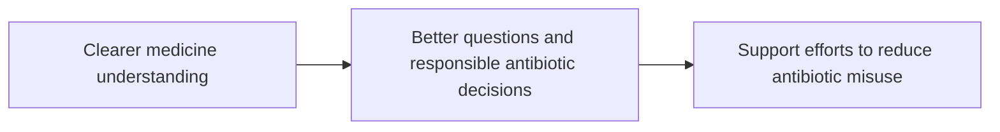

# What we are building

ResistGuard is an educational medicine-label web app. It helps people understand ingredients and prepare better questions for a pharmacist. It does not diagnose, prescribe, confirm authenticity or approve personal suitability.

# What we want to achieve

Built: guided scanning, 16 sourced records, conservative matching, approved explanations, learning tools and pilot/review tools.

Still to demonstrate: usability on physical phones, professional content approval, participant understanding and real-world impact. The final goal is an ambition, not an outcome already proven by this demo.
