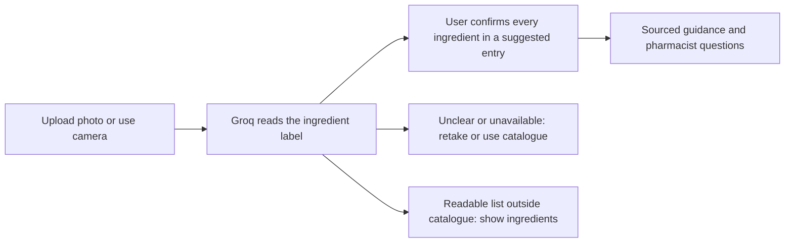
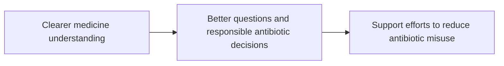

# What we are building

ResistGuard helps people understand medicine labels, recognise situations where antibiotics may be misused, and prepare questions for a pharmacist. It is an educational demo for learning about responsible antibiotic use and antimicrobial resistance (AMR).

## What each page is for

| Page | Purpose |
|---|---|
| **Medicine check** | Use the camera or upload a photo to read active ingredients. Compare every ingredient with a suggested catalogue entry before confirming. The practice tutorial shows why an incomplete list can lead to a wrong match. |
| **Antibiotic use** | Explore fictional examples involving eczema, a boil, sildenafil with nitrates, or diclofenac and a history of ulcers. Read source-linked guidance, prepare questions for a pharmacist and try the interactive AMR lesson. |
| **Catalogue** | Browse 28 source-checked generic records. Search ingredients, selected Nigerian brands or NAFDAC numbers, and view sourced formulation examples from adult and children’s lists. Pharmacist review is pending. |
| **Learn & try** | Practise with fictional package labels, answer short knowledge checks and explore the sources. |
| **Example insights** | Preview how an education dashboard could present activity and topics using synthetic data. |
| **Pilot & review** | Download the pharmacist review packet and pilot protocol. Record consented facilitator observations separately from the scan result and export them when the participant agrees. The participant pilot has yet to start. |

## How a label check works

# What we want to achieve

The first evaluation will measure whether people catch ingredient mismatches and know when to ask for help. Physical-phone testing, pharmacist sign-off and participant evidence are still pending. [Verification record](../VERIFICATION.md)
